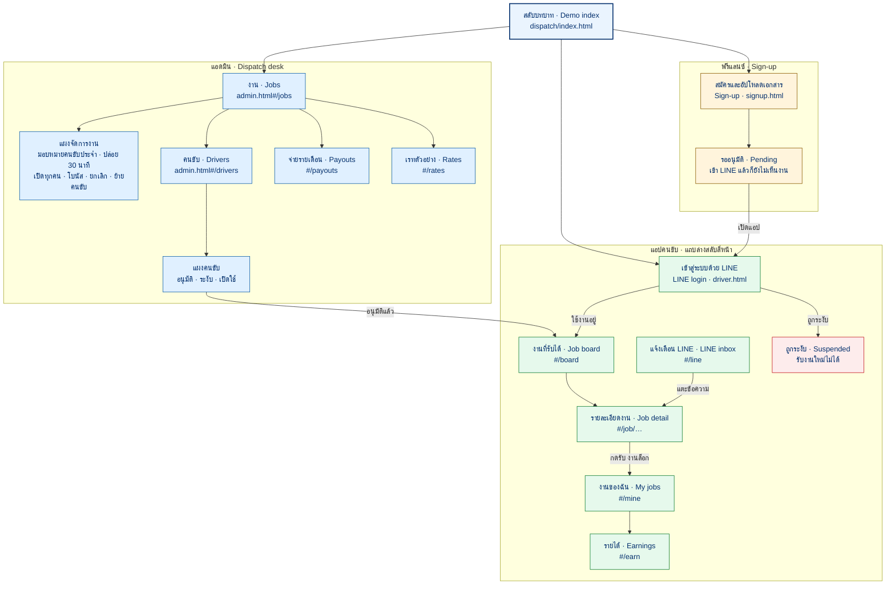
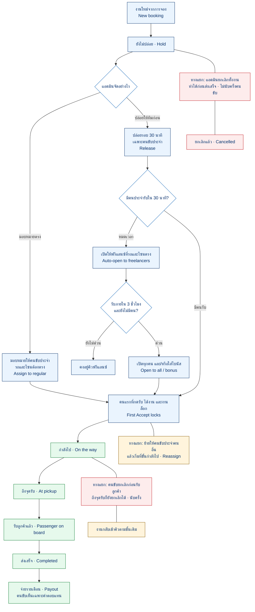
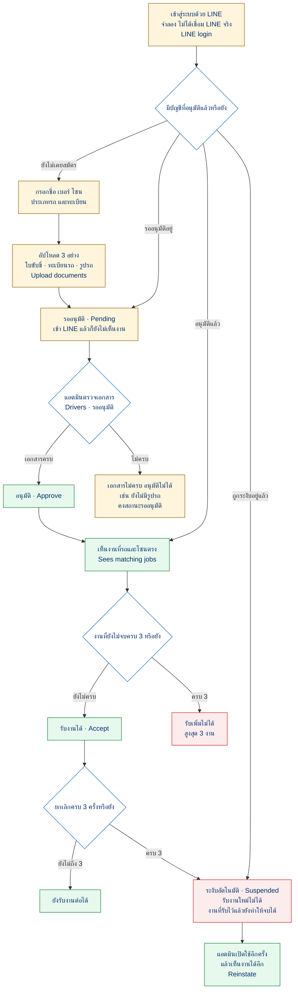
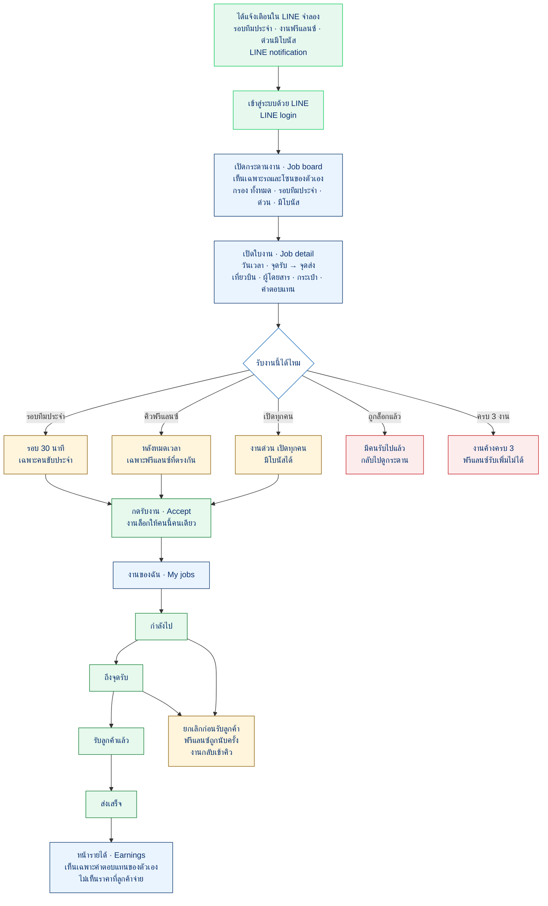

# แผนผังเดโมจัดงานคนขับ

Example data only. These maps describe the browser demo in `dispatch/`. They are not linked from the public site.
Labels are Thai. English names are the screen names. Source files are the `.mmd` files in `dispatch/`.

## แผนผังหน้า

Sitemap by role. หน้าเดโม สลับบทบาท โต๊ะแอดมิน แอปคนขับ และสมัครฟรีแลนซ์ ลูกศรคือลิงก์ในเดโม.

## วงจรจัดงาน

Job lifecycle. งานใหม่ไปจนถึงจ่ายเงิน รวมทางแยกยกเลิกและย้ายคนขับ.

## สมัครฟรีแลนซ์

Freelancer onboarding. เข้า LINE อัปโหลดเอกสาร รออนุมัติ จำกัด 3 งาน และระงับเมื่อยกเลิกครบ 3 ครั้ง.

## วันทำงานของคนขับ

Driver day. จากการแจ้งเตือน LINE จนส่งลูกค้าเสร็จ.

